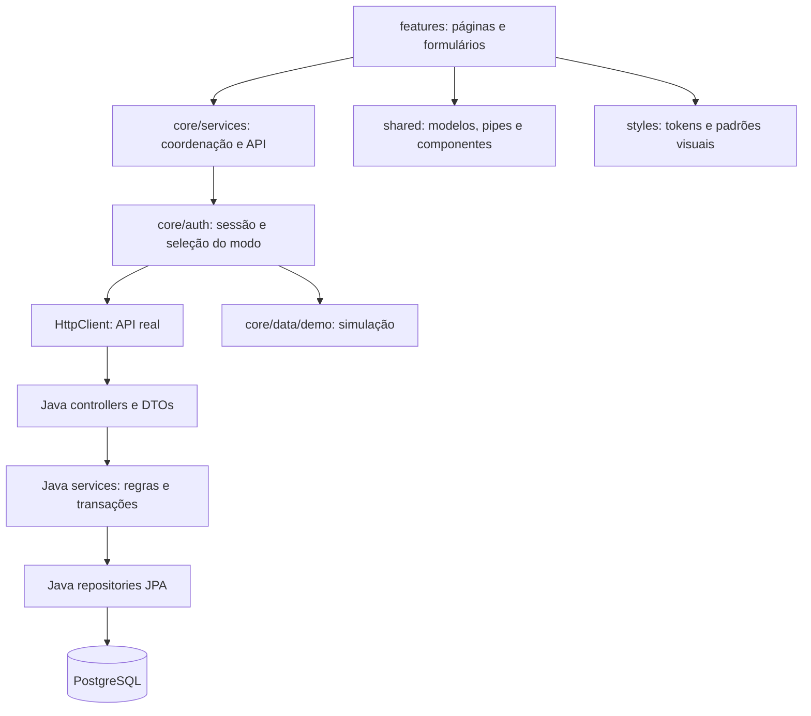

# Arquitetura e preparação para produção

Referência: 01/11/2026, Africa/Maputo. Frontend e checkout Java irmão inspecionados. **Ainda não aprovado para operação financeira em produção.** Não foi publicado nada, alterado esquema ou importado qualquer dado.

## Resposta direta

Existe frontend real, API real e código de persistência. Não estamos apenas a editar textos. Contudo, uma página funcionar não comprova que os seus dados estejam na base partilhada. Em desenvolvimento, uma falha de rede no login permite entrar no modo de demonstração: JSON e localStorage do navegador. Outros computadores não partilham esses dados e limpar o navegador pode apagá-los.

| Parte | Evidência | Situação |
|---|---|---|
| Frontend | Angular 19.2, TypeScript 5.7, NG-ZORRO 19.1, RxJS, HttpClient, guards, formulários | Código real, em execução na porta 4301 |
| API | Java 17, Spring Boot 3.4.1, Spring Security, JWT, controllers e services | Código real; sem listener local na porta 8080 durante a inspeção |
| Base de dados | JPA/Hibernate, driver PostgreSQL e URL de desenvolvimento para wsm_water_db | Serviço a escutar na porta 5432; esquema e dados não foram consultados |
| Demonstração | JSON e localStorage, agora isolados em core/data/demo | Simulação de desenvolvimento, nunca fonte financeira de produção |
| Produção configurada | URL HTTPS em Render no environment.prod.ts | Não foi comprovada a disponibilidade nem a versão do serviço publicado |
| Documentos | jsPDF/AutoTable e recibos derivados dos pagamentos na API | PDF não equivale a arquivo fiscal imutável |

O listener na porta 5432 não prova o conteúdo, integridade ou mesmo que a base configurada esteja criada. A sessão aberta no navegador não foi inspecionada. Não se consultou a BD remota.

## Camadas

- **features:** interação, formulários, apresentação e validação imediata. Não decide a dívida oficial nem a autorização definitiva.
- **core/services:** preserva os serviços e contratos atuais, coordena comunicação com API e documentos.
- **core/auth:** sessão, permissões, guards e modo de dados. O backend continua responsável por autorizar.
- **core/data/demo:** implementação do armazenamento simulado, fisicamente separada nesta etapa. Reexportação no caminho antigo mantém a compatibilidade e a mesma classe de injeção.
- **shared/models e utils:** contratos e funções puras, sem rede ou armazenamento. Ainda é necessário alinhar completamente os modelos aos DTOs.
- **shared/components e pipes:** ações, estados, metadados, filtro anual e apresentação de datas reutilizáveis.
- **styles/_tokens.scss:** fonte única dos tokens CSS e aliases para os nomes antigos.
- **styles/_operational-ui.scss:** regras comuns de botões, tabelas, densidade e foco.
- **Java:** controllers/DTOs para HTTP; services para regras/transações; models/repositories para persistência; infra para configuração e segurança. Company já está organizado por funcionalidade. Não se deslocaram todas as classes Java nem se mudaram endpoints.

É uma organização incremental do projeto existente. Componentes grandes, CSS legado e diferenças de contratos ainda exigem trabalho; não se afirma que todos os problemas arquiteturais ficaram resolvidos.

## Alterações aplicadas

1. Centralização das cores principais, superfícies, bordas e tons semânticos das etiquetas. Páginas existentes passam a usar as variáveis. Tons contextuais de marca e ilustração não foram todos eliminados.
2. Regras comuns para botões, estados desativados/perigosos, foco por teclado, tabelas, paginação e títulos das listas. Preservadas as ações e etiquetas partilhadas anteriores.
3. Listas de clientes e pagamentos passam a usar a função monetária dos detalhes: MZN apresentado como MT, com duas casas decimais.
4. BusinessDatePipe aplicado às datas operacionais: dd/MM/yyyy HH:mm, dd/MM/yyyy, MM/yyyy ou dd/MM HH:mm conforme o contexto, sempre Maputo. Timestamps Java sem offset são interpretados como hora do negócio, conforme a função existente. Não modifica datas guardadas.
5. Simulador movido para core/data/demo. Chamadas diretas são recusadas em produção ou quando a demonstração é desativada. Produção declara useLocalFallback=false.
6. Build de produção exclui public/data/**. Os JSON originais permanecem para desenvolvimento; não foram migrados para PostgreSQL.
7. Build mantém otimização de scripts e estilos. Apenas a incorporação automática das fontes externas foi desativada para evitar dependência de download durante o build. Roboto continua ligado externamente no HTML, com fallback de sistema; hospedar a fonte localmente continua pendente.
8. Backend: inicializador de administrador padrão restrito ao perfil dev, remoção da impressão de credenciais e contas demo explicitamente desativadas no perfil prod. **Contas já existentes não foram eliminadas nem tiveram PINs alterados.**

Não houve revisão visual de todas as páginas: o navegador integrado não pôde ser inspecionado. Compilar não prova a aparência em todas as resoluções. Os PDFs não foram redesenhados nesta etapa.

## Convenções comuns

| Contexto | Regra |
|---|---|
| Ficheiros novos Angular | kebab-case, sufixos component/service/pipe conforme responsabilidade |
| Classes/tipos | PascalCase; campos e métodos camelCase |
| Contratos | Preservar nomes e códigos existentes; não traduzir enums na API |
| Interface | Rótulos legíveis; PT/EN preservados; ainda há textos PT fixos por migrar |
| Métodos desconhecidos | Indicação explícita; não presumir numerário |
| Dinheiro | Função money existente, MT e duas casas; nunca calcular a partir do texto formatado |
| Datas | BusinessDatePipe para saída; ISO nos contratos; Africa/Maputo nas regras |
| Meses | YYYY-MM; ano e mês individuais na persistência; suporte 2012–2099 preservado |
| Tabelas | Densidade e cabeçalho comuns, ações partilhadas, números tabulares |
| Downloads | DocumentFilenameService existente: PREFIXO_REFERENCIA.pdf |
| API futura | DTOs explícitos e erros consistentes, após identificar os consumidores |

## Riscos e lacunas

| Prioridade | Situação e evidência | Próxima correção |
|---|---|---|
| P0 | Não há prova ponta a ponta com BD real; API local sem listener | Homologação: criação, pagamento, leitura e recuperação verificados no PostgreSQL |
| P0 | PaymentService.generateReferenceCode usa count()+1; referência tem unicidade | Sequência/contador transacional e série acordada, testados entre clientes diferentes |
| P0 | Métodos legados de edição/exclusão financeira continuam no controller/service, mas o filtro HTTP os bloqueia | Remover percursos inseguros e implementar anulação auditada; não liberar os endpoints existentes |
| P0 | Permissões de anulação/auditoria existem, mas não foram encontrados os fluxos correspondentes | Implementar motivo, aprovação e histórico; permissão declarada não prova funcionalidade |
| P0 | Payment.amount é Double; MonthlyCharge.amount é int | Contrato decimal/BigDecimal e NUMERIC, arredondamento e migração reconciliada |
| P0 | Prod usa ddl-auto=update; não há ferramenta de migrações no pom | Inventariar esquema, baseline e migrações versionadas; ensaiar backup/restauro antes de mudar para validate |
| P0 | A versão anterior podia criar administrador padrão em qualquer perfil | Inventariar contas existentes e trocar credenciais de teste; a correção não limpa dados antigos |
| P1 | Sync usa lock PESSIMISTIC_WRITE por cliente dentro do percurso transacional do pagamento | Existe proteção no código; testar concorrência real em PostgreSQL. Não afirmar ausência total de locks |
| P1 | Não foi encontrada chave de idempotência em PaymentInput/createNewPayment | Proteger retries e submissões repetidas; confirmação visual não resolve repetição de rede |
| P1 | Pagamento rejeita quantidade superior aos meses em dívida | Implementar adiantamentos rastreáveis e confirmação; não anunciar suporte completo |
| P1 | CustomerStatus backend só tem ATIVO/INATIVO | Instalação, cancelamento e reativação preservando dívida e histórico |
| P1 | Mensalidade usa snapshots, mas grupos/versões tarifárias completos não foram encontrados | Vigência e regra auditável para meses não pagos; preservar os pagos |
| P1 | ReceiptController deriva recibos; demonstrativo não é uma fatura de dívida completa | Entidade/itens/numeração/anulação/arquivo e identidade fiscal oficial |
| P1 | Respostas variam: Optional por ID, erros em texto/default e download de recibo em JSON | Definir contrato e Content-Type, identificar consumidores e migrar com compatibilidade |
| P1 | AuthService chama password/reset, mas não foram encontrados esses mappings no AuthenticationController | Confirmar serviço publicado e resolver funcionalidade anunciada mas ausente |
| P1 | CORS tem origens fixas antigas; TokenService e AuthInterceptor ainda merecem revisão de segurança | Origens por ambiente, duração/revogação JWT, proteção de credenciais e limitação de tentativas |
| P1 | Suite frontend não está completamente verde | Reparar configuração das specs antigas e acrescentar integração real |
| P2 | Rotas carregadas ansiosamente e bundle acima do aviso | Lazy loading e carregamento de PDF sob pedido, com medição |
| P2 | CSS legado extenso e texto PT fixo | Migrar exceções gradualmente; revisão visual e cobertura PT/EN |

Primeira mensalidade, cancelamento com pré-pagamentos e convenção final de documentos continuam a precisar de decisões de negócio. Não foram inventadas regras nesta etapa.

## Ordem de conclusão

1. Homologação com API e PostgreSQL separado, segredos fora do código e administrador provisionado de forma controlada. PIN 123456 não serve para operação real.
2. Inventariar dados e esquema reais. Definir origem dos dados e responsável por reconciliar saldos; não importar localStorage como contabilidade validada.
3. Reparar testes antigos e validar criação/mensalidades/pagamento/retries/concorrência/perfis com BD real.
4. Corrigir numeração, decimais e idempotência; implementar anulações/auditoria; migrações e recuperação ensaiadas.
5. Completar instalação, tarifas, adiantamentos e faturação conforme decisões de negócio.
6. Revisão visual por página e perfil; completar tradução e reduzir CSS/JS legado.
7. Ensaio operacional, reconciliação de valores/documentos, publicação e monitorização.

## Informação necessária antes de publicar

- Destino e domínio definitivos para frontend/API; acessos configurados de forma segura, sem enviar segredos pelo chat.
- Se já existe BD com dados reais, quem a administra e quais backups/restauros foram testados.
- Fonte autorizada de migração e responsável pela reconciliação.
- Identidade fiscal oficial, convenção de numeração e políticas financeiras pendentes.

Estas perguntas não bloqueiam continuar a corrigir o código; bloqueiam afirmar que uma publicação financeira é segura.

## Validação executada

- Suite completa antes: 86 testes Angular, 74 passaram e 12 falharam. Specs antigas com imports/providers ausentes, incluindo HttpClient e NzModalService.
- Suite direcionada: 33 passaram, cobrindo fronteira de produção, sessão/permissões, datas e componentes partilhados.
- Suite completa após integração: 93 testes, 81 passaram e as mesmas 12 specs antigas falharam. Dashboard atualizado para importar o pipe partilhado. **Não é uma suite totalmente aprovada.**
- npm run build: produção otimizada concluída; inicial cerca de 2,68 MB, acima do aviso de 2 MB, abaixo do limite de erro de 3 MB. Há avisos CommonJS, expressões opcionais e tamanho de estilo.
- Não foi encontrada pasta data no output browser do build de produção.
- Backend: Maven offline, 121 testes selecionados, zero falhas/erros. Inclui dois novos testes do inicializador por perfil. Não inclui prova de integração com BD real nem o teste completo de contexto.
- Nenhuma dependência nova, push, deploy ou alteração a dados reais. Sem lint configurado. Não foi feita auditoria de vulnerabilidades ou certificação fiscal.
